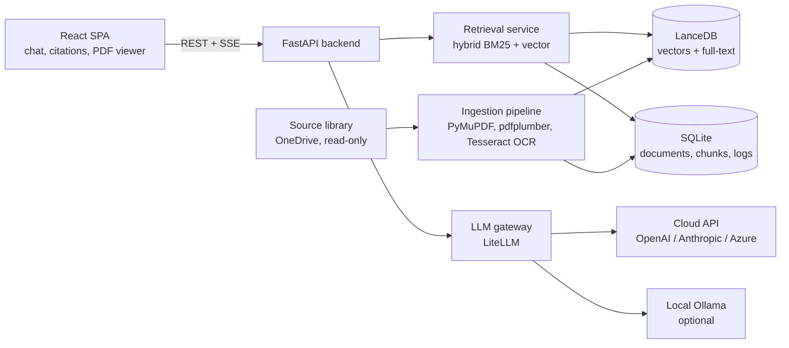

# 1 — Aviation Library Assistant: Project Plan

**Version:** 1.0 (problem-driven compliance, metadata history, regulatory fetcher)
**Date:** 2026-11-15
**Owner:** J. B. Martinolli
**Status:** Gates 0 and 1 passed. Phase 2 index is nearly complete (526 indexed, 2 partial, 1 `text_only`;
209,666 chunks; 528 documents with vectors). **Gate 2 is not passed**: the tuned retrieval (title-aware RRF, D-061) scores top-5 63.6%
(14/22) vs the 80% target; the owner reviewed the eight misses on 2026-11-15 and kept the current expected
pages, so no expectation changes were made. The LLM reranker (D-054) and `text-embedding-3-large` (D-062)
were tested and rejected. Phase 3 MVP is built and verified locally; **Gate 3 passed on 2026-11-14**. Phase 4
(compliance workspace, W3) is implemented beyond the original clause matrix: PDF/DOCX upload, indexed-library
document input, **problem-driven analysis first**, improvement reviews, the original clause-level gap review,
authority/source scoping, metadata-only run history and DOCX/XLSX export. The official-source fetcher is in
place and the approved core pack is downloaded, checksummed, indexed and vectorised: 14 CFR Parts 5, 91, 121 and
135 plus AC 120-92D and AC 21-58 (six FAA documents, 1,027 chunks), and the EASA Easy Access Rules for Air
Operations Rev 24 (2,566 pages, 3,038 chunks). The EASA XML archive is stored for future machine-readable use.
**FAA and EASA are the primary reference sources**; ICAO, GCAA, AQAP and NASA are secondary. The regulatory
inventory is in `13_Regulatory_Source_Inventory.md`; strategy is in `12_Flexible_Compliance_and_Regulatory_Expansion.md`.
The owner approved Option A (focused FAA/EASA core pack) and problem-driven analysis first. Gate 4 UAT is pending.

---

## 1. Purpose and vision

A private, password-protected web application that turns the owner's aviation library — aircraft theory, human factors and risk management, ISO/SAE quality standards, and later regulations and SMS material — into an interactive decision-support tool. The application answers questions grounded in the library, cites book, chapter and page, and supports daily work: occurrence analysis, risk assessment, compliance checks and report drafting.

The prototype is built first on three initial collections. Additional folders and capabilities are added after the prototype is validated.

## 2. Goals (prototype)

| ID | Goal |
|----|------|
| G1 | Ingest and index the three initial collections with page-level traceability. |
| G2 | Cited Q&A: every answer shows document, page and the quoted supporting passage. |
| G3 | At least three aviation-safety workflows: occurrence analysis, risk assessment support, checklist/report drafting. |
| G4 | Password access; runs locally on the owner's Windows PC; content leaves the machine only through explicitly configured LLM/embedding API calls. |
| G5 | Library management: browser, metadata (title, edition), approved renames, re-index without rebuilding everything. |
| G6 | Operational reliability: restart-safe, logged, with backup and restore of the index and configuration. |

## 3. Non-goals (prototype)

- Multi-user SSO, mobile apps, public internet hosting.
- Automatic tracking of regulatory revisions.
- Editing the content of source PDFs (renames only, with owner approval).
- Full multilingual support — English first; Spanish/Arabic can be added later if needed.

## 4. Success criteria

| ID | Criterion | Target |
|----|-----------|--------|
| S1 | Retrieval benchmark (25 questions with known answer pages) | Correct passage in top-5 results for ≥ 80% of questions |
| S2 | Answer grounding | ≥ 90% of sampled answers cite a real, relevant passage; no unsupported claims in spot checks |
| S3 | Performance | First token < 8 s (cloud API); typical full answer < 60 s |
| S4 | User acceptance | Owner completes 5 real work scenarios unaided |
| S5 | Security | Single password (Argon2id), localhost-only default, no secrets committed to git |

## 5. Users and access

Single user (the owner) for the prototype. The password is stored as an Argon2id hash; sessions use HttpOnly cookies; login attempts are rate-limited. Optional LAN access (other devices in the office) is a later switch, still password-protected. Multi-user roles are deferred.

## 6. Architecture (baseline)

**Components**

- **Frontend:** React SPA (Vite + Tailwind) with streaming chat, citation panel and PDF.js page viewer.
- **Backend:** FastAPI (Python 3.12), REST endpoints plus SSE streaming.
- **Ingestion worker:** command-line pipeline — PyMuPDF for text extraction, pdfplumber (or Docling if quality demands) for tables/layout, Tesseract OCR fallback for scanned pages, structure-aware chunking with metadata.
- **Index:** LanceDB (embedded vector + full-text hybrid search); SQLite for documents, chunks, metadata and query logs.
- **Embeddings:** pluggable — OpenAI `text-embedding-3-large` by default, or local `bge-m3` for offline mode.
- **Reranker:** optional cross-encoder (local) or API rerank, enabled only if retrieval tests show it is needed.
- **LLM gateway:** LiteLLM — OpenAI, Anthropic, Azure OpenAI or Ollama, selectable in settings.
- **Storage layout:** source documents stay untouched in OneDrive; application data (index, config, logs, backups) lives in `%LOCALAPPDATA%\AviationLibraryAssistant`.

**Why this stack:** Python is the strongest ecosystem for PDF/OCR/table parsing; LanceDB is embedded (no database server to administer); LiteLLM gives provider independence; React provides a professional chat and citation experience.

## 7. Ingestion pipeline

1. **Inventory and classification (Gate 0):** file listing, type/size/date, digital vs scanned detection (presence of a text layer), language, page counts.
2. **Parsing:** text PDFs → PyMuPDF; complex layouts and tables → pdfplumber (Docling as an upgrade path); scanned pages → OCR with Tesseract at 300 dpi.
3. **Metadata:** title, author, edition/year, collection, file path, checksum, page count, revision date.
4. **Chunking:** heading-aware; target 600–900 tokens with 10–15% overlap; every chunk carries document ID, page number and section path.
5. **Embedding and indexing:** batch embedding; vectors and full-text index stored together; build time logged.
6. **Quality checks:** extraction coverage (% pages with usable text), gibberish detection, table spot checks, OCR confidence.
7. **Re-ingestion:** checksum change triggers re-index of that document only; renamed files keep their document ID.

## 8. Retrieval and answering

Hybrid retrieval (BM25 + vector) → merge and deduplicate → optional rerank of the top 50 → context assembly (token budget configurable) → LLM answer under strict citation instructions → post-validation that cited pages exist and quoted text matches the source → display of citations with page previews.

**Query modes:** Quick answer; Deep analysis (wider retrieval, multi-step); Compare sources; Summarize section.

**Guardrails:** when retrieval confidence is low, the assistant says "not found in the library" instead of guessing, and always shows the retrieved passages.

## 9. Aviation-safety workflows (templates)

| ID | Workflow | Description |
|----|----------|-------------|
| W1 | Occurrence/event analysis | Structured analysis using ICAO Doc 9859 concepts (hazard, consequence, likelihood, severity, defences, bow-tie elements), pulling relevant passages. |
| W2 | Risk assessment support | 5×5 matrix guidance; suggests severity and likelihood with rationale and citations; outputs a table. |
| W3 | Compliance/gap check | Given a procedure or scenario, lists applicable requirements from indexed standards and flags gaps. |
| W4 | Report/checklist drafting | Memo, safety report or audit checklist with references. |
| W5 | Study/refresh | Explains a concept with book citations and page links. |

All templates are user-editable and stored in configuration, not hard-coded.

**Phase 4 implementation (approved 2026-11-15):** the compliance workspace accepts an owner-supplied PDF/DOCX
or an already-indexed library document. The default mode is problem-driven analysis: the owner describes an
operational or quality problem, selects FAA/EASA or other source collections, and receives a flexible,
evidence-backed narrative covering requirements, procedure evidence, gaps/conflicts, contributing factors,
risk, corrective actions, verification, limitations and page citations. An improvement review uses the same
narrative without forcing a matrix. The clause-level gap review remains available for explicit
document-versus-standard requests. Uploaded procedures are untrusted, transient input and are never added to
the library or embedded. Run history is metadata only (90 days, deletable).

## 10. Security and privacy

- Password hashed with Argon2id; HttpOnly session cookies; CSRF protection; login throttling.
- Server binds to `127.0.0.1` by default; LAN mode is an explicit opt-in.
- API keys stored in `.env` or Windows Credential Manager; never committed to git.
- Query logs stay local; export and clear options available.
- Source library is read-only except for approved renames (dry-run list shown and confirmed before any change).
- Copyright: private use only; no redistribution of book content; exports contain short quotes with citations.

## 11. Deployment and operations (Windows)

**Prototype options, in order of preference:**

1. **Docker Desktop + docker compose** — cleanest, if Docker is available and permitted on the PC.
2. **Native install** — Python 3.12 virtual environment plus a prebuilt frontend; `start.bat` launcher; optional Windows service.
3. **Packaged installer** — later, if distribution is needed.

**Backups:** daily copy of SQLite and LanceDB to `%LOCALAPPDATA%\AviationLibraryAssistant\backups` (keep 7). Restore script provided.

**Updates:** add documents through the UI or a watched folder; one-click re-index.

**Monitoring:** rotating logs and a health endpoint.

## 12. Roadmap and gates

| Phase | Scope | Deliverables | Gate criteria |
|-------|-------|--------------|---------------|
| **P0 — Discovery and inspection** | Inventory the three collections; parsing and OCR tests; rename proposal | Inspection report; benchmark question set (25 Qs) | **Gate 0:** parsing-quality report accepted; scope confirmed |
| **P1 — Foundation and design** | Project folder on PC, local git repo, plan documents, wireframes, architecture decisions | Wireframes, ADRs, updated plan | **Gate 1:** architecture and UX approved by owner |
| **P2 — Ingestion MVP** | Full pipeline; index for all three collections; benchmark run | Indexed library; benchmark results | **Gate 2:** S1 met (≥ 80% top-5); parse coverage ≥ 95% of pages |
| **P3 — App MVP** | Login, cited chat, library browser, PDF viewer, settings | Working app demo | **Gate 3:** demo passes; no critical bugs |
| **P4 — Workflows and export** | Templates W1–W5, Word/PDF/Markdown export, query history | Workflow-enabled app | **Gate 4:** UAT scenarios 1–5 passed |
| **P5 — Hardening and handover** | Security review, backups, install guide, user manual, sign-off | Release package and manuals | **Gate 5:** owner acceptance; go-live on work PC |
| **P6 — Optional expansion** | More folders/regulations, multi-user, revision tracking, GitHub sync | Scoped per request | New gate per feature |

**Indicative effort** (focused work blocks of 2–4 hours): P0 1 block; P1 1–2; P2 2–3; P3 3–4; P4 2–3; P5 1–2. Calendar time depends on review cycles and API availability.

## 13. Risks and mitigations

| ID | Risk | Mitigation |
|----|------|------------|
| R1 | Scanned or low-quality PDFs | OCR assessment in Gate 0; OCRmyPDF preprocessing; flag low-confidence documents |
| R2 | Tables and figures lose meaning | Layout-aware parser; page-image citations so the owner always sees the original |
| R3 | OneDrive cloud-only placeholders are slow or fail | Hydrate on demand; keep the index in `%LOCALAPPDATA%`, outside OneDrive sync |
| R4 | LLM hallucination | Strict citation prompt, post-validation, "not found" behaviour, low temperature |
| R5 | API cost or privacy concerns | Token budgets; cheaper models for summaries; local Ollama mode |
| R6 | Windows/IT restrictions (Docker blocked) | Native install path and portable zip |
| R7 | Copyright | Private use, access control, no redistribution |
| R8 | Standards revisions | Revision metadata and a re-ingest workflow (automation in P6) |
| R9 | Library growth | Incremental indexing and collection filters |

## 14. Decisions (confirmed 2026-11-13)

| ID | Decision | Resolution |
|----|----------|------------|
| D1 | Application name | **AeroVault** — Aviation Safety & Risk Library Assistant |
| D2 | Project folder on PC | `C:\Users\...\J_B_Martinolli\Projects\AviationLibraryAssistant` |
| D3 | LLM provider | OpenAI API — dedicated project key to be created by the owner |
| D4 | Deployment | Docker Desktop (installed on the PC) |
| D5 | Access scope | Localhost only for the prototype |
| D6 | Language | English |
| D7 | UI style | Clean light theme, aviation blue accents |
| D8 | Version control | Local git from Phase 1; GitHub repository after milestones |
| D9 | File renames | Dry-run proposal submitted for approval before any change |
| D10 | Hydration of the three collections | "Always keep on this device"; 245.9 GB free |
| D11 | Duplicate handling | SHA-256 verification, then quarantine (no deletion) |
| D12 | Project location | Preferred `C:\Users\...\AeroVault`; working copy in `DOCUMENTOS REVISION\AeroVault` until the root folder is granted |
| D13 | Parallel preparation while files hydrate | Approved — naming convention, wireframes, retrieval benchmark |
| D14 | GitHub repository | Created after Phase 1; owner reviews before any push |

## 15. Project records

- All planning and control documents live in `Project_Documents/` as numbered Markdown files: `1_Project_Plan.md`, `2_Step_Log.md`, `3_Inspection_Report.md`, `4_Naming_Convention.md`, `5_Wireframes.md`, `6_Retrieval_Benchmark.md`; `7_Architecture_Decisions.md` and `8_User_Manual.md` are added during the build.
- The step log is updated at every milestone and gate: date, action, result, next step.
- A local git repository is created in Phase 1; GitHub sync happens after milestones, per the owner's workflow preference.

## 16. Gate 0 results (2026-11-13)

- 755 files inventoried; 639 PDFs; 10,292.1 MB; **210,502 pages**.
- 630/639 PDFs parsed: 570 full text layer, 7 partial, 53 scanned (20,221 pp OCR workload).
- 9 exceptions: 6 AES-encrypted (auto-resolvable in the app), 2 password-locked bowties files, 1 pending hydration.
- 117 exact duplicates (1,019.5 MB) hash-verified and quarantined; nothing deleted; 10 unmatched `(n)` files retained.
- Detail: `3_Inspection_Report.md` v1.0.

## 17. Immediate next steps

1. Owner runs Gate 4 UAT on the problem-driven workflow: one real problem brief with an uploaded procedure, one with an indexed document, one improvement review and one gap review; verify citations and both exports.
2. The FAA/EASA Option A core pack is downloaded, checksummed, indexed and vectorised: seven documents / 4,065 chunks (FAA Parts 5/91/121/135, AC 120-92D, AC 21-58; EASA EAR Air Operations Rev 24). The EASA XML archive is retained for future section-level processing.
3. Add a small source register/revision view. Retrieval has been tested against known FAA and EASA clauses; eCFR text sources still cite page 1, so section-level citation mapping is the next improvement.
4. Resume the OCR backfill only when the owner is not using the app; Gate 2 remains open at 63.6% top-5 (14/22) with the owner-confirmed expectations.
5. Run the live `gpt-4o-mini` problem test after the citation-verification change; the first live run completed with 12 FAA citations and a complete narrative, and the new evidence-to-page validator plus regression test now reject unsupported pages.
